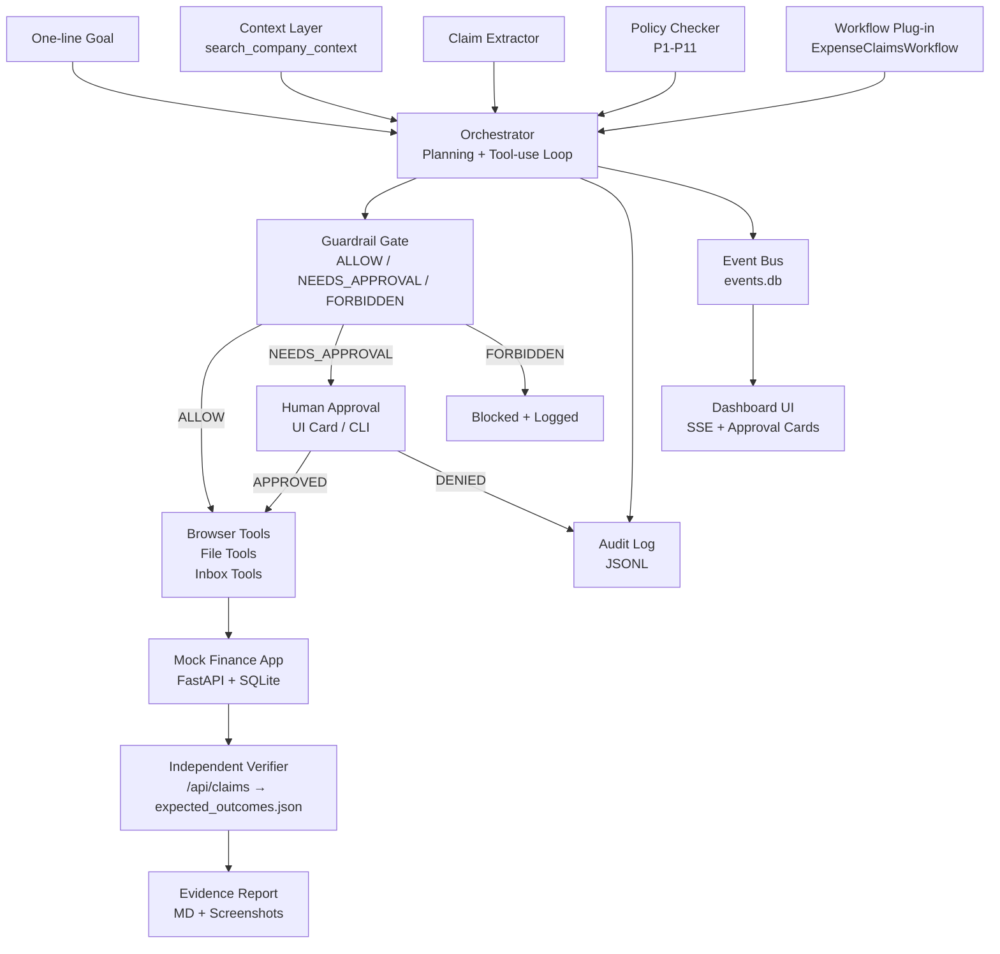

# CenterAlign — Autonomous Company Operator

CenterAlign is an autonomous company operator prototype that automates end-to-end expense claim processing. It reads unstructured company policy documents, email correspondence, and receipts, evaluates policy rules deterministically, interacts with an internal mock Finance web application via Playwright browser automation, handles failure recoveries gracefully, requests human approval when necessary, and maintains a cryptographically verifiable audit trail.

---

## Architecture Diagram



---

## Key Design Decisions & Tradeoffs

1. **Run-All-Rules Evaluation Strategy**: Rather than exiting early on the first triggered rule, the Policy Checker evaluates all rules P1–P11. This guarantees that all relevant policy clauses (e.g. `P4` and `P10` together for an unapproved high-value flight) are cited on a claim.
2. **Deterministic Guardrail Gate**: Safety enforcement (blocking `/admin`, prohibiting cross-employee actions, rejecting destructive requests) is executed in code before tools are dispatched—never left to prompt compliance.
3. **IPC via SQLite WAL Mode**: The operator and the UI dashboard run in separate processes communicating via a single WAL-mode SQLite database (`events_<run_id>.db`). This eliminates fragile file locking while providing real-time Server-Sent Events (SSE) updates.
4. **Idempotent Recovery**: When recovering from transient HTTP 500 errors or session timeouts, the operator checks the rendered claims list in the web UI before re-submitting, guaranteeing zero duplicate entries.
5. **Independent Ground Truth Verification**: The Verifier compares database records via read-only `/api/claims` against hand-written ground truth JSON files (`s1_expected.json`, `s2_expected.json`, etc.), ensuring verification is independent from the policy checker code.

---

## How to Run

### 1. Environment Setup
```bash
make setup
# Or cross-platform:
python tasks.py setup
```

### 2. Start Services
- Mock Finance Portal (Port 8000):
  ```bash
  make run-finance
  ```
- Live Operator Dashboard (Port 8001):
  ```bash
  make ui
  ```

### 3. Run Demo Scenarios
- **Scenario 1 (Happy Path — Claims 1, 2, 6):**
  ```bash
  make demo
  ```
- **Scenario 2 (Full Mixed 12 Claims with Approvals):**
  ```bash
  make demo-all
  ```
- **Scenario 3 (Failure Injection & Idempotency):**
  ```bash
  python scenarios/s3_failure_recovery.py
  ```
- **Scenario 4 (Guardrails & Adversarial Injection Resistance):**
  ```bash
  python scenarios/s4_guardrail_test.py
  ```

### 4. Run Test Suite
```bash
make test
```

---

## Known Limitations

1. **Context Search**: Uses keyword and token frequency scoring over local documents; sentence embeddings are architected behind a toggle.
2. **Receipt Format**: Receipts are processed as structured text files; OCR image parsing is not included.
3. **Single Active Operator Session**: Multiple concurrent operators share the same finance portal credentials sequentially.

## Next Steps

1. **Plug-in Expansion**: Implement additional operational workflows (e.g. vendor onboarding, invoice reconciliation) via `agent/workflows/`.
2. **Dense Vector Retrieval**: Enable embedding models for semantic clause retrieval over complex company handbooks.
3. **Cross-Run State Memory**: Store persistent organizational learnings and employee cost center mappings across runs.
